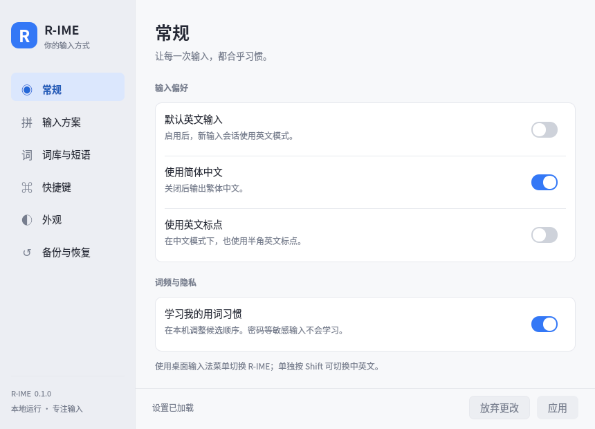
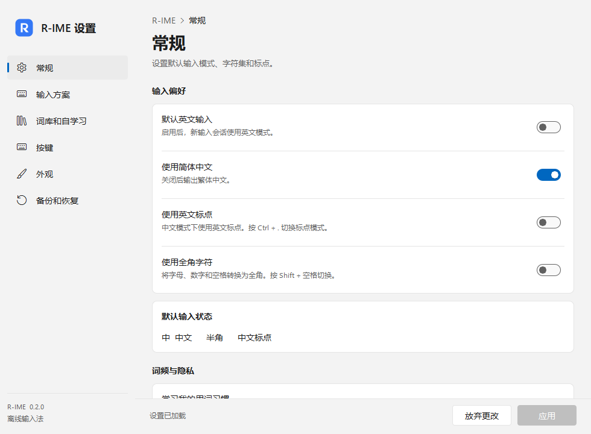

# R-IME

一个支持 Linux / Windows 的中文系统输入法：独立的 Fcitx 5 / Windows TSF 入口、Rime 输入核心，
Windows 版本采用接近 Windows 11 微软拼音的候选窗、系统“中 / A”状态和 Fluent 设置界面；
Linux 版本保留简洁的专属候选窗和偏好设置。

默认离线全拼、简体。支持小鹤与自然码双拼、简繁切换、用户词频学习、
自定义短语、快捷键、独立外观和本地备份。
Windows 支持 Shift 切换中英文、Shift + 空格切换全半角、Ctrl + 句号切换标点，
上下键逐项选择候选。应用接管 TSF 候选界面时，R-IME 会按应用要求显示或隐藏自己的窗口。

## Windows 安装

Windows 11 x64 提供 64 位引擎和设置程序，以及 64 / 32 位 TSF 组件。
Windows 设置界面需要 Qt 6.11+，使用 FluentWinUI3 控件。
在普通 PowerShell 窗口运行打包目录的 `install.ps1`；安装程序会请求提升权限，
将系统组件放入 `Program Files\R-IME`，再为当前用户启用输入法和启动项。
按 **Win + 空格** 选择 **R-IME**，从开始菜单打开 **R-IME 设置**。

源码构建、安装和卸载命令，以及实际测试范围见 [Windows 指南](docs/windows.md)。
macOS InputMethodKit 接入尚未实现。
Qt 设置外观包含无可见系统标题栏、圆角及可关闭的背景材质；系统降低透明度或高对比度时使用实色。
macOS 仅可单独验证外观模块和离屏 QML，完整设置程序仍依赖尚未移植的 Linux IPC 接口，不代表 macOS 系统输入法支持。
忙状态和未保存更改确认、候选条的系统角色保持不变。隔离测试和原生验收边界见 [窗口外观验证](tests/window_chrome.md)。

## Linux 构建

首要构建基线为 Debian 13，Fcitx 5 ≥ 5.1.12、Qt 6 ≥ 6.8、C++20。
在 Linux 中执行：

```sh
sudo sh packaging/install-build-deps.sh
cmake -S . -B build -G Ninja -DCMAKE_BUILD_TYPE=RelWithDebInfo -DCMAKE_INSTALL_PREFIX=/usr
cmake --build build -j2
ctest --test-dir build --output-on-failure
sudo cmake --install build
```

发行版的 `rime-prelude`、`rime-essay`、`rime-data-luna-pinyin`、
`rime-data-double-pinyin` 提供基础预设、语言模型及词库；
R-IME 安装自己的三个覆盖方案，不读取现有 fcitx5-rime 的用户目录。

只编译引擎及配置测试可添加 `-DRIME_BUILD_FCITX=OFF -DRIME_BUILD_SETTINGS=OFF`。
设置程序与系统输入法是独立进程，关闭设置不会中断输入。

## 本地控制接口

`r-ime-ctl` 提供 JSON 命令行和常驻 JSON Lines API，可查询状态、切换默认方案/模式、
修改配置、管理短语和备份恢复；C++ 应用可链接 `RIME::control`。
每个连接的输入会话互相隔离，配置更新具有并发冲突检查。
命令、Python 示例与 SDK 用法见 [控制接口指南](docs/control-api.md)。

## 在 KDE 启用

1. 安装发行版的 Fcitx 5、配置工具，以及 GTK/Qt 应用所需输入模块。
2. 在 KDE 系统设置的虚拟键盘/输入法入口选择 Fcitx 5，并重新登录。
3. 在 Fcitx 5 输入法配置中添加 **R-IME**，关闭语言筛选后可查找中文输入法。
4. 从应用菜单打开 **R-IME 设置**，或从输入法状态菜单进入。
5. 首次启动需要编译本地词库。准备完成后即可使用系统快捷键切换到 R-IME。

KDE/Wayland 的接入方式依发行版而异，请遵循
[Fcitx 官方 Wayland 指引](https://fcitx-im.org/wiki/Using_Fcitx_5_on_Wayland)。
不要为所有应用盲目设置同一组 `GTK_IM_MODULE` / `QT_IM_MODULE` 环境变量。
应用不支持专属输入面板时会退回 Fcitx 标准候选窗；设置中可查看诊断。

## 数据与卸载

- 配置：`$XDG_CONFIG_HOME/r-ime/config.json`，默认 `~/.config/r-ime/config.json`。
- 词库与短语：`$XDG_DATA_HOME/r-ime`，默认 `~/.local/share/r-ime`。
- 运行时 socket：`$XDG_RUNTIME_DIR/r-ime/engine.sock`，仅当前用户可访问。
- 短语文件：UTF-8 TSV，每行为 `编码<TAB>文字<TAB>权重`，支持 `#` 注释。
- 备份为带版本的 JSON 文件。导出与恢复通过引擎执行，避免复制正在写入的词库。

使用原构建目录卸载：`sudo cmake --build build --target uninstall`。
卸载保留用户配置和词库；先在 Fcitx 中移除 R-IME，再重新启动 Fcitx。

## 验证范围

自动化覆盖真实 Rime 输入、协议与会话隔离、配置/词库失败恢复、候选布局及设置。
完整桌面验收清单与实际执行结果见 [验证记录](docs/verification.md)。
Windows 的构建、TSF 宿主和安装验证单独记录在 [Windows 指南](docs/windows.md)。

架构见 [architecture.md](docs/architecture.md)。少量 Fcitx Wayland 封装保留在
`src/fcitx/vendor`，上游来源和 LGPL 许可证随源码及安装一起提供。




