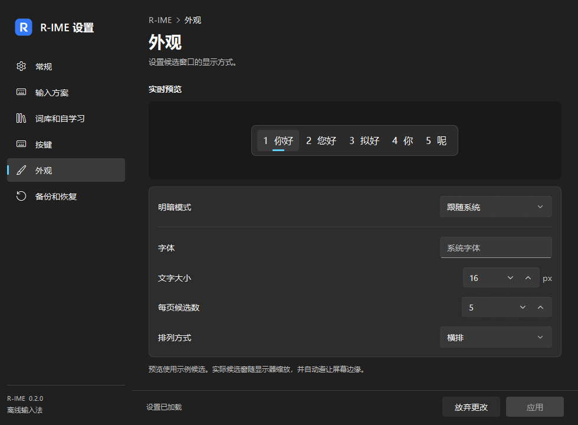

# Windows 使用与开发

R-IME 使用 Windows Text Services Framework（TSF）接入系统输入。
64 位和 32 位应用各自加载对应的 COM DLL；独立的 64 位 worker 承载 librime，
设置程序使用 Qt 6 Quick。输入、候选显示及设置共用 Linux 版本的配置模型。

## 构建与安装

需要 Windows 11 x64、Visual Studio 2022 的 C++ 桌面工具链、Windows SDK、
CMake 3.22+、PowerShell 7，以及 Qt 6.11+ 的 `msvc2022_64` 版本。
首次构建会下载固定版本的 librime、nlohmann/json 和 yaml-cpp；输入运行时无需联网。

```powershell
./packaging/windows/build.ps1 -QtRoot 'C:\Qt\6.11.1\msvc2022_64' -CMake 'cmake'
./build-windows/package/install.ps1
```

`build-windows/package` 是可复制的完整程序目录，包含 Qt、VC 运行库、Rime 词库和许可证。
安装命令从普通用户 PowerShell 执行，系统阶段会请求 UAC 提升权限：

- 将程序复制到 `C:\Program Files\R-IME\0.2.0-<时间戳>`。
- 注册两个位数的 COM 组件和独立的中文 TSF 配置项。
- 为当前用户添加输入法、开机启动项以及开始菜单的“R-IME 设置”。
- 从普通用户进程启动引擎，保留原有默认输入法。

通过 **Win + 空格** 选择 **R-IME**。首次启动需要部署词库。
单独按 Shift 切换中英文；Shift + 空格切换全半角，Ctrl + 句号切换中英标点。
空格和数字选词，上下方向键逐项移动候选并可跨页，左右方向键移动预编辑光标；
Enter 提交原始输入，Esc 取消。系统切换快捷键仍由 Windows 管理。
候选窗使用紧凑的 Windows 11 风格、系统字体、灰色序号、选中底板和强调色指示条；
为无激活的所属应用窗口，支持明暗、高对比度、横竖排及缩放，不置于所有应用之上。
预编辑使用 TSF 下划线属性，由应用按自身主题绘制。
输入法模式入口使用“中 / A”，品牌入口保持 R 标识。
六页设置使用 FluentWinUI3 控件与 Windows 设置式导航，保留系统标题栏。
语言栏菜单和 `ITfFnConfigure` 都可打开独立设置程序。

应用通过 TSF UIElement 接管候选窗时，R-IME 提供真实的当前页候选字符串、选中项、
选择与取消操作，并遵循应用允许/拒绝显示窗口的决定。文档滚动或布局改变时会重新定位；
布局尚未就绪时先隐藏。失焦、过期异步选词及不支持同步编辑的上下文不会重复提交。

## 数据与卸载

安装目录中的 `r-ime-ctl.exe` 提供本地控制 API 和 JSON 命令行，可查询状态、设置默认方案/模式、
修改配置、管理短语及备份恢复。脚本可使用常驻 `rpc` 桥接获得独立输入会话。
命令、错误和会话失效约定见 [控制接口指南](control-api.md)。

用户文件位于 `%LOCALAPPDATA%\R-IME`：

| 子目录或文件 | 用途 |
|---|---|
| `config/config.json` | 输入与外观配置 |
| `data/rime` | 独立的 Rime 用户词库 |
| `cache`、`runtime` | 部署缓存与运行状态 |
| `installation.json` | 已安装版本、路径及安装状态 |
| `installation-attempt.json` | 未完成或失败的安装记录，不覆盖已有成功安装 |

命名管道仅允许当前用户 SID 访问，拒绝远程连接。每个输入上下文使用独立会话，
断开后不重放按键，失焦时取消组合；密码及敏感输入范围绕过候选和学习。
测试可通过 `RIME_USER_ROOT` 指定隔离目录，普通使用无需设置此变量。

卸载使用已安装目录中的脚本：

```powershell
$installation = Get-Content "$env:LOCALAPPDATA\R-IME\installation.json" -Raw | ConvertFrom-Json
& (Join-Path $installation.directory 'uninstall.ps1')
```

卸载会提升权限以移除系统注册，移除本用户入口与启动项，并保留用户词库及配置。
其他应用可能仍加载 TSF DLL，关闭这些应用或注销后才能删除剩余程序文件。
安装失败会保留带具体错误的安装清单，便于重试或卸载。
首次安装未完成时，可直接运行打包目录的 `uninstall.ps1` 清理已完成的部分。

## 图标更新与本机验证（2026-09-29）

Windows 输入法列表使用蓝底白色 R 标识。语言栏中文模式使用蓝色 R，英文模式使用灰色 R；
设置程序也使用同一品牌图标。图标包含 16～256px 多种分辨率，嵌入 64 / 32 位 DLL，
不依赖外部图标文件。按 `Win + 空格` 选择 **R-IME** 后，在输入区域键入 `nihao`。

该轮安装版本为 `0.2.0-20260929014714`。两种位数的实际安装组件均通过系统 COM 和
Windows 按键分发验证，包含品牌图标解码、候选窗在屏幕内显示、提交后隐藏和中文提交。
结果保存在 `.cache/installed-validation-991ce30c31df4047b2027c05009623cc`。
本轮普通 CTest 的临时注册 TSF 宿主未激活测试服务，尚未解决；不能宣称本轮全套通过。
Windows 引擎回归重试通过。下面的 8/8 结果是上一版本的历史记录。

## 前一版本验证（2026-09-28）

环境：Windows 11 x64 build 26300、Intel Core i9-14900K、MSVC 19.44、
Windows SDK 10.0.26100、Qt 6.11.1、librime 1.17.0。

此前安装版本为 `0.2.0-20260928235332`，位于 `C:\Program Files\R-IME`。
安装清单状态为 `installed`；启动项、开始菜单和正在运行的引擎均指向此版本。
以下 64 / 32 位系统分发验证已在这份最终安装上复验通过。

```powershell
ctest --test-dir build-windows -C Release --output-on-failure
# 安装之后，通过系统 COM 注册和 TSF 按键分发验证实际接入：
./tests/verify_windows_install.ps1
```

完整 Windows CTest **8 / 8 项通过，耗时 9.53 秒**。覆盖全拼、两种双拼、简繁、
会话隔离、敏感会话、短语部署、备份恢复、非法配置及 Unicode 路径。
恢复测试包含“现有短语文件损坏时，仍能恢复有效备份”。
安装器另有失败恢复测试：模拟连续两次系统安装失败，验证保留最后成功版本、
独立记录本次错误，并保持卸载与下一次重试所需的信息：

```powershell
./tests/windows_install_test.ps1 -InstallScript "$PWD/packaging/windows/install.ps1" -PackageDirectory "$PWD/build-windows/package"
```

64 位与 32 位已安装组件均通过真实系统 COM 和 Windows 按键分发验证：
`nihao` 产生预编辑，空格提交“你好”，Esc 取消新组合且不重复提交。
独立 TSF 回归还验证点击选词、不抢焦点、失焦取消、密码/只读上下文、Shift、
快捷键热更新，以及应用不能提供同步编辑锁时按键透传。

已安装组件测试使用自建 `ITextStoreACP` 桌面宿主。后台自动化进程受 Windows 前台焦点规则限制，
因此脚本使用 Windows SDK Debugging Tools 的 x64/x86 CDB 启动测试宿主；
安装与日常输入均不依赖调试器。每次测试创建独立词库并写出明确的 JSON 成败结果，
不把调试器自身的退出码当成测试通过。依据为 Windows 的
[前台窗口规则](https://learn.microsoft.com/en-us/windows/win32/api/winuser/nf-winuser-setforegroundwindow)。

兼容性边界：这些自动化测试不能代替 Word、浏览器、Electron 等实际应用矩阵，
UWP / AppContainer、多显示器和完整缩放矩阵仍需复验。
尚未测得 Windows 按键到候选显示的端到端 P95，不能据此宣称达到 30ms 目标。

TSF 官方接口参考：[Text Services Framework](https://learn.microsoft.com/en-us/windows/win32/tsf/text-services-framework)。

## Windows 11 改造审查（2026-10-07）

本轮修复了候选 UIElement 缺失、系统模式状态未同步、键盘获焦通知未恢复输入、
滚动后候选定位不更新、预编辑没有显示属性、应用拒绝编辑时吞键、异步旧候选错误提交、
初始化失败后复用失效会话，以及旧备份恢复后新增设置不能立即编辑的问题。
测试数据目录短暂被占用时，部署/回滚仅针对指定 Win32 文件占用错误重试最多 1 秒；
持续权限错误或目标冲突仍报具体错误，并保留回滚机制。

旧版配置和备份无需手工编辑：缺少 `full_shape` 时补为半角，已有配置和用户词库保留。
Rime 输入行为与词库继续离线使用。本轮改造针对 Windows 外观、常用操作和公开 TSF 接口，
不宣称微软私有云词库、预测、手写、语音服务或所有界面像素完全等价。

验证命令（打包会回写 `build-windows/bin/share`，必须与测试串行执行）：

```powershell
ctest --test-dir build-windows -C Release --output-on-failure
./tests/verify_windows_install.ps1
./build-windows/bin/windows-engine-test.exe --latency
```

本机带 SDK Debugging Tools 时，普通 ACP 文档回归使用 CDB 并检查测试宿主 JSON 结果，
抑制等待引擎启动时预期的首次 C++ 异常报告。无法获得真实桌面前台焦点时，此项明确跳过；
输入错误仍失败。已安装组件验证必须实际获得前台，不能用跳过结果视为通过。
安装验证分别覆盖 x64/x86 的普通窗口与 UI-less 宿主允许/拒绝候选显示四种组合。

六个 Windows 设置页面已完成浅深色共 12 次 QML 加载检查；候选窗完成实际渲染检查。
该轮完整串行 CTest 结果为 **9/9 通过，21.55 秒**。
该轮本机版本为 `0.2.0-20261007225431`，安装于 `C:\Program Files\R-IME`。
该版本 x64/x86 普通与 UI-less 四项真实系统分发验证均通过；结果目录为
`.cache/installed-validation-f3c37d6ff811496d9db8ba3833f1df96`，每项含 JSON 与调试日志。
worker/IPC 首键探测最大 1.4732 ms，仅代表独立引擎测试，不是包含 TSF/绘制的端到端 P95。
本轮没有完成真实 Word/浏览器/Electron/UWP 应用矩阵、整套多显示器缩放矩阵或 Linux 图形回归。




## 控制接口验证（2026-10-08）

新增独立 C++20 控制 SDK、JSON 命令行和常驻 JSON Lines 桥接；使用指南见
[本地输入法控制接口](control-api.md)。配置及短语更新使用有效快照检查并发冲突，
失败响应明确区分输入错误、冲突、引擎错误和传输错误，并报告会话是否失效。

本轮完整串行 Windows CTest **12/12 项通过，0 跳过，67.00 秒**。
新增检查覆盖真实私有输入会话、非法请求后继续使用桥接、UTF-8 参数与文件路径、
短语增删改及导入导出、默认方案/模式、备份恢复、过期快照拒绝、
文件写入失败回滚、部署和备份失败后的会话失效，以及超限请求发送前拒绝。
原有设置、候选窗和真实 TSF 宿主回归也全部通过。

x64/x86 输入组件与控制工具均构建通过，x86 控制 API 检查单独通过。
关闭引擎、设置、Fcitx 和 TSF 后的独立控制 SDK 构建/安装通过；
使用非默认 `CMAKE_INSTALL_INCLUDEDIR=include/r-ime`，外部 CMake 项目通过
`find_package(RIME)` 链接 `RIME::control` 并成功查询已安装引擎。

本机已安装版本 `0.2.0-20261008004524`，目录为
`C:\Program Files\R-IME\0.2.0-20261008004524`。
安装清单为 `installed`；引擎、设置、控制工具与 x64/x86 DLL 均与构建产物一致，
当前用户引擎正在运行此版本。真实应用、多屏与端到端性能的验收边界仍按上文记录。

已安装组件的 x64/x86 普通及 UI-less 四项真实系统分发验证通过，
已安装 CLI 的 `status` 和 `config get` 也通过。x64 普通宿主结果位于
`.cache/installed-validation-304b26b945624ad1896dbe113553771b`；首次 UI-less 尝试
因未获前台焦点失败，单独复测及其余项通过的结果位于
`.cache/installed-validation-72b836cfcfc74714b63e3443c1cf6659`。
安装失败恢复测试再次通过：连续两次模拟系统安装失败后，已有成功版本清单保持不变，
失败尝试单独记录，不修改真实用户安装。
